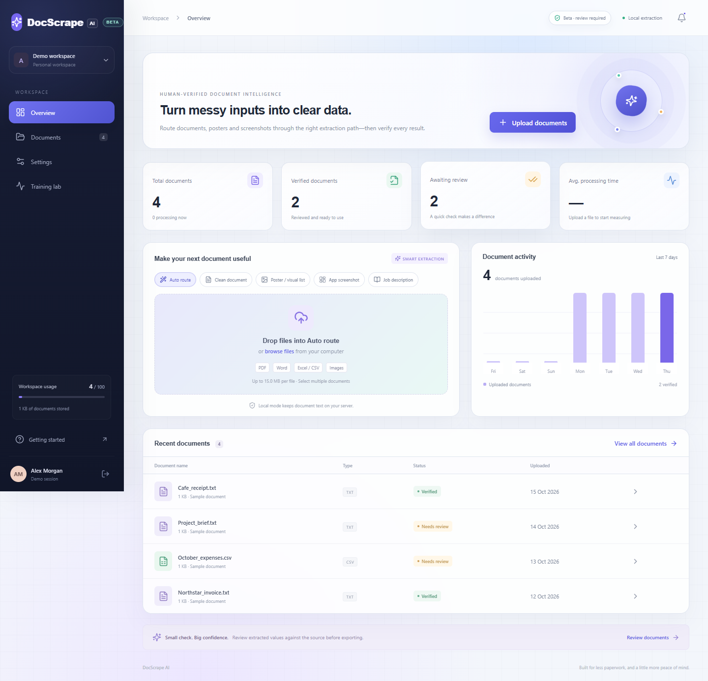
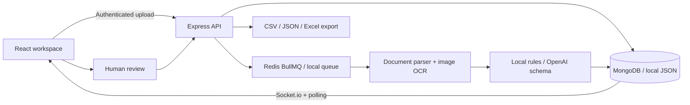

# DocScrape AI

**Turn everyday documents into useful, verified data.** A full-stack document workspace with OCR, optional AI extraction and a side-by-side review workflow.

Built with React, TypeScript, Express and MongoDB. Starts locally without a database or paid API key; Docker enables MongoDB, Redis, legacy Office conversion and scanned PDF OCR.



## Quick start

Requires **Node.js 22.12+** (Node 24 recommended).

```bash
npm ci
npm run dev
```

Open **http://localhost:5173**, then click **Explore live demo**. The demo creates a private session with synthetic samples. Or register your own account and upload documents.

On Windows PowerShell, use `npm.cmd` if execution policy blocks `npm.ps1`:

```powershell
npm.cmd ci
npm.cmd run dev
```

No environment file is needed for local mode. A random development session secret is generated at startup; sign in again after a server restart. To keep sessions across restarts, copy `server/.env.example` to `server/.env` and set `JWT_SECRET` to a random value.

## What works

- Registration and login with password hashing, JWT cookies and per-user workspaces.
- Drag-and-drop or multi-file upload with extension/signature validation, archive expansion limits and upload quotas.
- Document queue, processing status over Socket.io and polling fallback.
- Real text parsing for PDF, Word, Excel, CSV and TXT; real image OCR with Tesseract.
- Local rule-based extraction with explicit source evidence; optional OpenAI structured extraction.
- Explicit beta routes for Auto, clean documents, posters, app screenshots and job descriptions.
- Side-by-side source text and editable fields; editable line items; human verification.
- Layout-aware headings and numbered/bulleted sections for posters and guides, with editable names, original numbering, evidence and uncertainty flags.
- Original-image preview alongside cleaned text and untouched OCR; title and summary editing; reprocessing for older uploads.
- Multi-sheet Excel previews and exports; cached formula values are read, formulas are never evaluated.
- CSV, JSON and Excel exports, plus original-file downloads.
- Document search, status filters, deletion, failed-job retries and restart recovery.
- Actual upload activity, verified counts, storage usage and measured processing times. No invented accuracy scores.
- Responsive spatial dashboard, isolated demo workspaces, sample-file generator, API tests, browser smoke tests and CI.

### Beta extraction routes

Choose a route before upload. **Auto** preserves general invoice/receipt/spreadsheet detection. **Poster** uses OCR positions to group headings and numbered labels. **App screenshot** prioritizes visible alert titles, messages and actions. **Job description** groups overview, responsibilities, minimum requirements, preferred qualifications and shift requirements. **Clean document** keeps ordinary text-first processing. Every route remains human-reviewed; selecting a route does not turn OCR output into guaranteed truth.

### Supported formats

| Category   | Formats                                                                    | Processing                                         |
| ---------- | -------------------------------------------------------------------------- | -------------------------------------------------- |
| PDF        | `.pdf`                                                                     | Embedded text; scanned documents via Poppler + OCR |
| Word       | `.docx`, `.doc`                                                            | DOCX text parser; legacy DOC via LibreOffice       |
| Excel      | `.xlsx`, `.xls`                                                            | Multiple worksheets; legacy XLS via LibreOffice    |
| Plain data | `.csv`, `.txt`                                                             | UTF-8 CSV tables / plain text                      |
| Images     | `.jpg`, `.jpeg`, `.png`, `.webp`, `.gif`, `.tif`, `.tiff`, `.bmp`, `.avif` | Normalization and text recognition                 |

Docker includes LibreOffice and Poppler. Outside Docker, install them on your system or set `LIBREOFFICE_BIN` and `PDFTOPPM_BIN` to their executable paths. Without those tools, DOC/XLS and scanned PDFs return an actionable processing error. Animated and multi-frame images process their first frame. HEIC, SVG, encrypted documents and macro-enabled Office formats are not supported.

### Honest local mode

Local mode is **real parsing plus layout and text rules**, not a simulated AI model. It extracts explicit `Label: Value` fields and simple numeric line items. Posters use OCR word coordinates and relative text size to group headings and list labels; text-only guides use a simpler list parser. Without reliable grouping, content stays as an excerpt rather than fabricated structured data. OCR recognition data downloads on first image processing; internet is needed once per language, then data is cached in `server/data`.

### Posters and section review

Open a processed poster to see the **Original image**, **Cleaned text**, **Original OCR / text**, and editable **Sections**. Each section has a heading, numbered or unnumbered items, original evidence and a `needsReview` flag. Repeated labels are retained, wrapped labels are joined, and numbered lists are sorted by their original numbers. Apparent source misspellings are retained instead of being silently replaced with dictionary names.

JSON includes sections and both source-text views. CSV adds section rows, while Excel adds a **Sections and items** worksheet. Use **Reprocess document** (the wand in the review footer) for older uploads; confirmation explains that it replaces extraction edits and verification but keeps the original file. Older stored results remain readable without migration.

Layout grouping is heuristic: unusual layouts, missing list markers, small text and multi-column text-only documents may need manual review. The local mode does not identify poses from their illustrations. AI mode receives text, coordinates and grouping hints, and flags unmatched or rewritten label evidence.

## Optional AI extraction

Copy `server/.env.example` to `server/.env`, then configure:

```dotenv
AI_PROVIDER=openai
OPENAI_API_KEY=your-own-server-side-key
OPENAI_MODEL=gpt-4o-mini
```

Restart the API. Uploaded document text is then sent to OpenAI through the Responses API with a strict JSON schema and `store: false`. Keys never enter the frontend. Provider refusals, incomplete results and quota failures become visible failed jobs; the app does not silently replace AI results with fake data. The document is treated as untrusted data and instructions inside it are ignored by the extraction prompt.

Source: [OpenAI Structured Outputs documentation](https://developers.openai.com/api/docs/guides/structured-outputs).

## Architecture



```text
client/src/         React UI, API client, responsive styles
server/src/         Auth/API, storage, processing, parsing, exports
server/tests/       API boundaries and real-format parser tests
server/scripts/     Synthetic sample-file generator
scripts/            Browser workflow verification
docs/               API and deployment documentation
artifacts/          Screenshots and browser verification artifacts
```

### Storage and queue choices

The local store serializes writes and persists JSON atomically. It is designed for **one local server process**. Configure `MONGODB_URI` for production storage and `REDIS_URL` for a durable BullMQ queue. Uploads remain on a persistent disk volume. The Docker setup runs one API/worker instance with MongoDB and Redis. Horizontal scaling would additionally need shared object storage, atomic global quota accounting and coordinated job recovery.

## Checks and sample files

```bash
npm run typecheck
npm test
npm run build
npm run samples
```

Samples are generated in `samples/generated/`: TXT, CSV, XLSX, DOCX, PDF, PNG, JPG and WebP. Use them to demonstrate the app without any employer or customer data.

Production-build preview:

```bash
npm run build
npm start
```

Open **http://localhost:4000**. The API serves the built frontend.

Browser smoke test, with the app running:

```bash
npx playwright install chromium
node scripts/browser-smoke.mjs
npm run test:beta
```

You can use an existing browser by setting `BROWSER_EXECUTABLE` to Chrome or Edge's executable. The checks cover demo login, routed job-description extraction, editing, verification, export, library search, settings and mobile overflow, and write screenshots into `artifacts/`.

## Docker

Copy `.env.example` to `.env` in the repository root and replace the example `JWT_SECRET` with at least 32 random characters. Then:

```bash
docker compose up --build
```

Open **http://localhost:4000**. MongoDB, Redis and upload data persist in named volumes. The local Docker example explicitly permits HTTP cookies. For public deployment, use HTTPS, `COOKIE_SECURE=true`, a real `CLIENT_ORIGIN` and persistent storage. See [deployment instructions](docs/DEPLOYMENT.md).

## Limits and verification

Default: 15 MB per upload, 100 documents per workspace, 60,000 extracted characters, 10 Excel sheets, 500 rows × 50 columns per sheet, first 10 text-PDF pages and first 5 scanned-PDF pages. Truncation is surfaced as review warnings. Office archives are capped at 40 MB expanded size / 2,000 entries; images are capped at 40 megapixels.

AI and OCR are fallible. `Verified` means a user marked the result reviewed, not an accuracy guarantee. Confidence and financial correctness are not inferred from verification. The side-by-side text is a normalized source view; original layout is available through download.

Session cookies are HTTP-only, SameSite=Lax and secure by default in production. API paths enforce ownership, request origin checks, rate limits and strict payload validation. Export cells that look like spreadsheet formulas are escaped. Password resets, team invitations, paid subscriptions, malware scanning, account retention automation and compliance certification are outside this portfolio MVP.

## GitHub showcase

Pin this repository and add a live demo link after deploying. Keep these screenshots in the README; include a 60-second walkthrough showing upload → review → verified Excel export. Explain the provider interface, queue, validation and ownership checks in interviews. Add your own branding and design changes so you can discuss your decisions confidently. Never upload employer code, customer documents, credentials or runtime data.

[API reference](docs/API.md) · [Deployment guide](docs/DEPLOYMENT.md) · [Verification record](docs/VERIFICATION.md)

## Local English/Hindi training lab

Local accounts have a **Training lab** with human-approved cropped-line labels, explicit train/validation/test splits, baseline runs, experiment history, CER/WER/grapheme metrics, actual predictions, native CPU-training logs and a candidate release check. The lab is blocked for demo sessions and disabled in production.

Image reviews also include **Correct & add to training**: draw a crop around one text line, enter its exact label and save it directly to the local dataset. Crops from one document are locked to one split, while crossed-out or illegible lines remain excluded.

Training stays on your computer. This Windows machine uses its existing Ubuntu WSL environment with native Tesseract training tools; **Docker Desktop is not required**. `npm run training:setup` prepares pinned training sources. Docker remains an optional alternative through `npm run training:build`. Initial free model/tool downloads need internet; fine-tuning uses prepared local assets and no paid API.

Actual 100-iteration English and Hindi fine-tuning smoke runs completed on synthetic train/validation/test fixtures. English was rejected because it did not improve an already-perfect baseline; Hindi passed its small fixture comparison. **Neither candidate was activated or deployed.** Real model improvement needs your checked, representative data and a much larger acceptance test. Native reports remain in ignored `server/data/native-training-smoke.json`.

See the [step-by-step local training guide](docs/LOCAL-TRAINING.md). Model-only improvements need an approved model-artifact update, not a frontend redeploy. Code changes need the normal application deployment. A passing smoke comparison is not proof of real-world accuracy.
